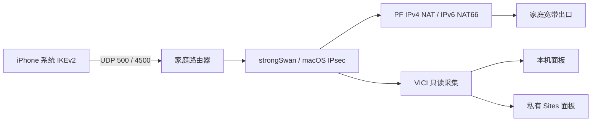

# macOS Native IKEv2 Home VPN

以 Apple Silicon Mac 为家庭出口、使用 iPhone 系统 VPN 开关的 IKEv2/IPsec 工程源码。服务端采用 strongSwan、macOS PF_KEY/PF_ROUTE 和 PF，包含双栈转发、设备证书、连接恢复、DDNS、本机监控及私有网页面板。

**这是完整的脱敏工程源码发布，不是通用的一键安装产品。** 原工程从一台已有证书、网络配置和安装记录的 Mac 演进而来。公开版保留运行逻辑、构建材料及回归测试，去除了真实凭据、手机配置、状态和旧机绑定。换机部署必须重新建立 PKI、网络参数及发布清单；不能把示例地址直接安装到现有服务器。见 [配置说明](docs/configuration.md) 和 [源码构建边界](docs/server-source.md)。

## 功能与结构

- iOS 原生 IKEv2，按设备签发身份，通过 `.mobileconfig` 安装。
- IPv4、IPv6 内层全隧道；支持 IPv4 外层，以及单独配置并验收的 IPv6 外层 UDP 500/4500。IPv6 内网地址经 macOS PF NAT66 使用家庭宽带的 IPv6 出口。
- 多设备独立地址、连接状态和策略处理，覆盖换钥、断开重连、网络切换及瞬时观察失败。
- DNS 随隧道转发；普通手动配置启用全流量路由。Mac 在服务端终止会话后的正式断开窗口已观察到直出，不能承诺零泄露；主动关闭、正式断开和连接中重试需分别验证。
- 每秒采样设备状态/速度/今日用量；私有面板展示近 24 小时、每 30 分钟区间的用量，可筛选设备。
- Dynadot DDNS、launchd 生命周期、日志、撤销及维护工具源码。



| 目录 | 内容 |
| --- | --- |
| `server/` | 当前 VPN 控制层、设备签发、策略、恢复、构建参考与发布模板 |
| `native/` | 上游原生依赖的版本、摘要和编译配方 |
| `monitor/` | 采集器、本机界面及上传器 |
| `ddns/` | Dynadot 更新、凭据导入及调度源码 |
| `web/` | 私有监控网站、数据库迁移和前端测试 |
| `maintenance/` | 有限权限维护辅助工具 |
| `tests/` | 不改宿主网络的核心回归 |
| `docs/` | 配置、构建、运维、验证和已知限制 |
| `third_party/` | 第三方许可与来源说明 |

## 从这里开始

```sh
git clone https://github.com/furongwangyuan/macos-native-ikev2.git
cd macos-native-ikev2
python3 scripts/check_source.py
```

这个检查只读取源码，不需要管理员权限，不启动 VPN。组件测试和原生编译分别见下列文档。

1. [配置总览与部署顺序](docs/configuration.md)
2. [原生依赖构建](docs/native-build.md)
3. [服务器源码、参考包和离线测试](docs/server-source.md)
4. [监控与私有站点](docs/monitor.md)
5. [DDNS](docs/ddns.md)
6. [日常运行、恢复与更新](docs/operations.md)
7. [验证记录与限制](docs/validation.md)
8. [安全与凭据处理](SECURITY.md)、[第三方许可](THIRD_PARTY_NOTICES.md)

## 发布范围

包含本项目的作者源码、必要 vendored VICI 库、配置示例、原生依赖构建脚本和文档。strongSwan/OpenSSL/pkgconf 通过固定版本和 SHA256 获取，不重复上传整个上游源码包或本机 Mach-O 二进制。

不包含真实 CA/私钥、P12、可登录的手机配置、DDNS 口令、上传令牌、设备用量、访问记录、原机日志或私人域名。公开仓库不会提供访问原家庭 VPN 的身份。

原工程曾完成单台 iPhone 的双栈上网、DNS、重连和网络切换验证；外层 IPv6 入口已上线，Mac 参考测试已通过内层双栈 HTTPS。当前版本的 iPhone IPv6 入口和长期、跨运营商表现仍待验收。源码回归覆盖多设备场景，但不代表任意新 Mac 的安装兼容性、两台真实手机并发、各运营商可达性或 200 Mbps 性能。公开版的验证范围见 [validation.md](docs/validation.md)。

## English

Source release of a native Apple Silicon macOS IKEv2/IPsec home gateway, with iOS built-in VPN profiles, dual-stack forwarding, per-device control, DDNS and monitoring. It is a sanitized engineering reference, **not a generic unattended installer**. New deployments require their own PKI, network bindings and release manifests. Existing live credentials and operational data are intentionally excluded. See the configuration and validation documents before building or deploying.
